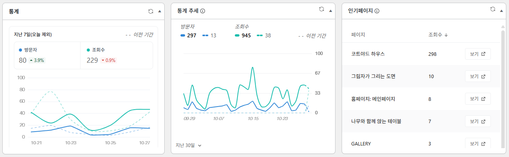

# Goyo Statistics

## 설치 방법

1. GitHub 저장소에서 **Code → Download ZIP**을 눌러 ZIP 파일을 다운로드합니다.
2. 워드프레스 관리자에서 **플러그인 → 플러그인 추가 → 플러그인 업로드**로 이동합니다.
3. 다운로드한 ZIP 파일을 선택하고 **지금 설치**를 누릅니다. 압축을 풀 필요는 없습니다.
4. 설치가 끝나면 **플러그인 활성화**를 누릅니다.
5. **알림판 → 홈**에서 통계, 통계 추세, 인기페이지, 인기 도시 위젯을 확인합니다.

- 별도 설정 없이 활성화 후 새 방문부터 수집합니다.
- 사용 환경: WordPress 6.6 이상, PHP 7.4 이상

## 소개

- 플러그인: Goyo Statistics
- 설명: 알림판용 간단 통계 (버전: 1.01)
- 알림판에서 간단하고 가볍게 사용하기 위한 독립된 데이터·설정·방문 수집
- WP Statistics 코드 일부 차용, 두 개의 통계 플러그인 동시 활성화 가능 
- 기본 언어: 한국어 
